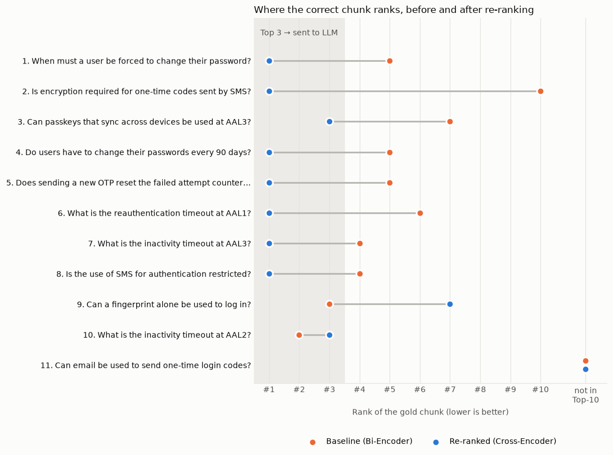
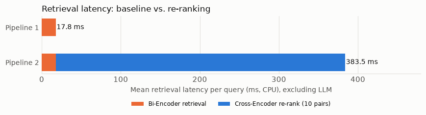

# RAG Assignment: Baseline Retrieval vs. Cross-Encoder Re-Ranking

**Name:** MD TAUFIQUE HUSSAIN  |  **Roll No.:** 2025202007

**GitHub:** <https://github.com/Taufiquesir/rag-baseline-vs-reranking>  |  **Report:** [`Report/LMA_A1_REPORT.pdf`](Report/LMA_A1_REPORT.pdf) (4 pages), LaTeX source: [`Report/RAG_Report.tex`](Report/RAG_Report.tex)

This repository contains the code for LMA Assignment 1. It builds a small **Retrieval-Augmented Generation (RAG)** system over one long technical PDF and compares two ways of choosing the text that is given to the LLM:

1. **Pipeline 1 (Baseline):** a fast embedding model (Bi-Encoder) picks the chunks.
2. **Pipeline 2 (Re-Ranking):** the same candidates are re-scored by a slower but more careful model (Cross-Encoder) before they reach the LLM.

The goal is to show *where* and *why* the baseline picks the wrong text, how re-ranking fixes it, where re-ranking does **not** help, and what it costs in time.

Everything is in one notebook: **[`RAG_Baseline_vs_ReRanking.ipynb`](RAG_Baseline_vs_ReRanking.ipynb)**. It is saved with all its outputs (tables, answers, charts), so you can read it on GitHub without running anything.

---

## Table of contents

1. [What is RAG and what are we comparing?](#1-what-is-rag-and-what-are-we-comparing)
2. [The document](#2-the-document)
3. [How the system works, step by step](#3-how-the-system-works-step-by-step)
4. [How we test it (evaluation method)](#4-how-we-test-it-evaluation-method)
5. [Results](#5-results)
6. [Main findings](#6-main-findings)
7. [Limitations](#7-limitations)
8. [How to run](#8-how-to-run)
9. [Repository layout](#9-repository-layout)
10. [Configuration you can change](#10-configuration-you-can-change)

---

## 1. What is RAG and what are we comparing?

An LLM does not know the contents of our PDF. In RAG we first **search** the PDF for the passages that are most likely to contain the answer, then paste those passages into the prompt and ask the LLM to answer **only from them**. If the search picks the wrong passages, the LLM either says it cannot find the answer or, worse, answers from the wrong text.

So the quality of the answer depends heavily on the search step. This project compares two search strategies over the **exact same chunks**:

```
                    ┌──────────────────────────── Pipeline 1 (Baseline) ───────────────────────────┐
 query ─► Bi-Encoder ─► cosine search over all chunks ─► Top 10 ─► take Top 3 as-is ─► LLM ─► Answer 1
                                                            │
                    ┌───────────────────────────────────────┴─ Pipeline 2 (Re-Ranking) ──────────┐
                    └─► Cross-Encoder scores all 10 (query, chunk) pairs ─► re-sort ─► Top 3 ─► LLM ─► Answer 2
```

| | Bi-Encoder (Pipeline 1) | Cross-Encoder (Pipeline 2, second stage) |
|---|---|---|
| Model | `sentence-transformers/all-MiniLM-L6-v2` | `cross-encoder/ms-marco-MiniLM-L-6-v2` |
| How it reads text | Query and chunk are turned into vectors **separately**; similarity = cosine of the two vectors | Query and chunk are fed **together** as one input; every query word can attend to every chunk word |
| Can work be done in advance? | Yes. All chunk vectors are computed once, offline | No. It must run once for every (query, chunk) pair at query time |
| Speed | Very fast | Much slower |
| Accuracy on subtle wording (negation, exceptions, numbers) | Weaker | Stronger |

Both pipelines use the **same Top-10 candidates, the same LLM and the identical prompt**. The only difference is which 3 chunks reach the LLM, so any difference between Answer 1 and Answer 2 comes from re-ranking alone.

---

## 2. The document

**NIST Special Publication 800-63B-4, *Digital Identity Guidelines: Authentication and Authenticator Management*** (July 2025, 129 pages).

This is the official US standard for computer-security authentication: password rules, multi-factor authentication, one-time passwords (OTP), SMS codes, passkeys, biometrics, account recovery and login-session timeouts.

Why this document is a good stress test for retrieval:

* **Negation.** Rules are written as `SHALL` / `SHALL NOT` / `SHOULD NOT`. For example: "Verifiers SHALL NOT require subscribers to change passwords periodically."
* **Exceptions next to rules.** For example: "…SHALL use approved encryption **unless** sent via the PSTN", or "**However**, verifiers SHALL force a change if there is evidence of compromise."
* **Near-duplicate paragraphs.** The three assurance levels (AAL1, AAL2, AAL3) have almost identical paragraphs that differ only in the level and a number (30 days / 24 hours / 12 hours).
* **Technical synonyms.** The document says "PSTN" (public telephone network) where a normal user would say "SMS".

It is a US government work in the public domain. Source: <https://doi.org/10.6028/NIST.SP.800-63B-4>.

Short glossary used in the notebook:

| Term | Meaning |
|---|---|
| AAL | Authentication Assurance Level (1 = lowest, 3 = highest) |
| Verifier / CSP | The system that checks a login / the credential service provider |
| Out-of-band (OOB) | A code sent to a second device, e.g. by SMS |
| PSTN | Public Switched Telephone Network (SMS and voice calls) |
| Syncable authenticator | A passkey that is copied between devices through the cloud |

---

## 3. How the system works, step by step

### 3.1 Loading and cleaning the PDF
Text is extracted page by page with `pypdf`. Two things are removed before chunking:

* **Front matter (first 11 pages):** title pages, legal notices, preface and a 4-page table of contents. The table of contents lists every section title, so it matches almost any question while containing no answers. Keeping it would make the baseline look worse for an unfair reason.
* **Running header and page number** on every page ("NIST SP 800-63B-4 / July 2025 / …"). Otherwise every chunk would share these words.

After cleaning: **118 pages, about 37,000 words.**

### 3.2 Chunking
A sliding window of **120 words with 30 words of overlap** gives **413 chunks**. A 120-word chunk holds about one requirement paragraph. The overlap makes sure a sentence that is cut at a chunk boundary still appears complete in the neighbouring chunk. Each chunk remembers the PDF page it came from.

### 3.3 Indexing (Bi-Encoder + FAISS)
All 413 chunks are embedded once into 384-dimensional vectors (about 13.5 s on CPU, one time only). The vectors are normalised, so FAISS inner product (`IndexFlatIP`) equals **cosine similarity**. The search is exact (no approximation), so the baseline is not weakened by the index.

### 3.4 Pipeline 1: Baseline
Encode the question, find the 10 most similar chunks, give ranks 1 to 3 to the LLM, and get **Answer 1**.

### 3.5 Pipeline 2: Re-Ranking
Take the same 10 chunks, let the Cross-Encoder give each (question, chunk) pair a relevance score, sort by that score, give the new ranks 1 to 3 to the LLM, and get **Answer 2**.

### 3.6 The LLM and the prompt
* Default: **`Qwen/Qwen2.5-1.5B-Instruct`**, a local open-weights model that runs on a laptop CPU with no API key.
* Optional: **Gemini** is used automatically if the environment variable `GEMINI_API_KEY` is set.
* Decoding is greedy (no randomness), so every run gives the same answers.
* The **same prompt template** is used for both answers. It tells the model to answer only from the given passages, to mention the section number, and to reply *"Not found in the provided passages."* if the passages do not contain the answer. This way, wrong context shows up as a refusal or a wrong answer instead of the model answering from its own memory.

---

## 4. How we test it (evaluation method)

**Gold chunk.** For every test question we take the exact sentence in the standard that answers it (the `gold_phrase`). Any chunk containing that sentence is the **gold chunk**. "Did the pipeline find the right text?" then becomes an objective check: *what rank did the gold chunk get?* Only ranks 1-3 reach the LLM.

**Expected answer.** For each stress-test question we also write the correct answer with its section number, and compare Answer 1 and Answer 2 against it.

**Four kinds of tests:**

1. **Stress tests (8 queries):** questions built to trigger the failure types listed in the assignment (exceptions, negation, keyword traps, buried chunks), plus **3 counter-examples** where re-ranking does not help. For each one the notebook shows the full Top-10 table before and after re-ranking, both answers, and an observation.
2. **Wider evaluation (48 questions, retrieval only):** every question we tried while searching for failure cases, including easy ones, ones where re-ranking got worse, and ones where the baseline missed completely. It is not a cherry-picked list. We report Hit@1, Hit@3 and MRR@10.
3. **Chunk-size robustness check:** the 48-question evaluation repeated with 100-, 120- and 150-word chunks.
4. **Latency and scaling:** each stage timed 20 times per query; the Cross-Encoder is also run over **all** 413 chunks to measure what happens without the Bi-Encoder stage.

Metrics:
* **Hit@k** = share of questions whose gold chunk is in the top k.
* **MRR@10** = average of 1/rank of the gold chunk (0 if it is not in the Top 10). Higher is better.

---

## 5. Results

### 5.1 Stress-test queries: where the gold chunk ranks

| # | Failure type | Query | Baseline to re-ranked |
|---|---|---|---|
| 1 | Exception | When must a user be forced to change their password? | #5 to **#1** |
| 2 | Exception (buried at the very end) | Is encryption required for one-time codes sent by SMS? | #10 to **#1** |
| 3 | Exception (level-specific) | Can passkeys that sync across devices be used at AAL3? | #7 to **#3** |
| 4 | Negation | Do users have to change their passwords every 90 days? | #5 to **#1** |
| 5 | Negation | Does sending a new OTP reset the failed attempt counter? | #5 to **#1** |
| 6 | Keyword trap (near-duplicate AAL rules) | What is the reauthentication timeout at AAL1? | #6 to **#1** |
| 7 | Keyword trap (near-duplicate AAL rules) | What is the inactivity timeout at AAL3? | #4 to **#1** |
| 8 | Synonym ("SMS" vs "PSTN") | Is the use of SMS for authentication restricted? | #4 to **#1** |
| 9 | Counter-example: re-ranking hurts | Can a fingerprint alone be used to log in? | #3 to #7 |
| 10 | Counter-example: order changes, still in Top 3 | What is the inactivity timeout at AAL2? | #2 to #3 |
| 11 | Counter-example: recall ceiling | Can email be used to send one-time login codes? | not in Top 10 (both) |



### 5.2 Answer 1 vs. Answer 2 (what the LLM actually said)

| # | Answer 1 (baseline context) | Answer 2 (re-ranked context) |
|---|---|---|
| 1 | Unclear, only points to a section (Sec. 3.1.1) | Correct: change is forced when there is evidence of compromise |
| 2 | Refused ("Not found") | Wrong: says encryption *is* required; missed the "unless PSTN" exception even though it was in the context |
| 3 | Right conclusion, wrong reason | Correct, with the right reason (syncing breaks AAL3's non-exportability rule) |
| 4 | Refused | Refused: the small LLM did not link "every 90 days" with "periodically" |
| 5 | Refused | Correct, quotes the rule |
| 6 | Refused | Correct: no more than 30 days |
| 7 | **Wrong: "1 hour"** (that is the AAL2 value, taken from a distractor chunk) | Correct: 15 minutes |
| 8 | Confused: mixes SMS with biometric sensors | Correct: SMS (PSTN) is a restricted authenticator |
| 9 | "No", but for wrong reasons | "No", but for wrong reasons |
| 10 | Correct | Correct |
| 11 | Refused (safe) | **Hallucinated "Yes"** (opposite of the rule) from an unrelated chunk about recovery codes |

The full answers, Top-10 tables and an observation note for every query are in section 7 of the notebook.

### 5.3 Wider evaluation (48 questions, retrieval only)

| Metric | Pipeline 1 (Bi-Encoder) | Pipeline 2 (+ Cross-Encoder) |
|---|---|---|
| Hit@1 | 0.250 | **0.500** |
| Hit@3 (gold chunk reaches the LLM) | 0.583 | **0.750** |
| Hit@10 (recall of stage 1) | 0.812 | 0.812 |
| MRR@10 | 0.437 | **0.617** |

* Gold rank improved in 19 questions, unchanged in 15, worse in 5. In 2 of those 5 the gold chunk dropped out of the Top 3.
* For 9 of 48 questions (19%) the gold chunk never reached the Top 10, so neither pipeline could succeed. Re-ranking cannot change Hit@10.

### 5.4 Chunk-size robustness

| Chunking | Chunks | Hit@3 P1 to P2 | MRR@10 P1 to P2 |
|---|---|---|---|
| 100 words / 25 overlap | 495 | 0.542 to **0.688** | 0.372 to **0.570** |
| 120 words / 30 overlap (main) | 413 | 0.583 to **0.750** | 0.437 to **0.617** |
| 150 words / 40 overlap | 338 | 0.583 to **0.708** | 0.450 to **0.639** |

Re-ranking helps at every chunk size, so the result does not depend on the 120-word choice.

### 5.5 Latency (laptop CPU: AMD Ryzen 5 5500U, no GPU)

| Stage | Mean | Median | p95 |
|---|---|---|---|
| Pipeline 1: Bi-Encoder retrieval (query embed + Top-10 search) | 17.8 ms | 17.5 ms | 23.2 ms |
| Pipeline 2: extra Cross-Encoder re-rank (10 pairs) | 365.7 ms | 350.4 ms | 489.2 ms |
| Pipeline 2: total retrieval | 383.5 ms | 368.1 ms | 509.4 ms |
| LLM generation (one answer) | ~51 s | ~51 s | ~56-60 s |
| End-to-end Pipeline 1 | 51.0 s | | |
| End-to-end Pipeline 2 | 52.1 s | | |

Re-ranking makes **retrieval about 21.5 times slower** (about +366 ms per query). That is under 1% of the baseline LLM generation time (about 51 s), but the *measured* end-to-end time rose from 51.0 s to 52.1 s (+2.1%). This difference also contains run-to-run variation of the LLM (the two LLM rows differ by 0.7 s), so it should not be blamed entirely on re-ranking. The slow CPU LLM dominates the total either way.



### 5.6 Scaling: why not use the Cross-Encoder on everything?

Measured: running the Cross-Encoder over **all 413 chunks** takes **16.9 s per query** (about 41 ms per pair), compared with 0.38 s for the two-stage pipeline. Extrapolated with the same per-pair cost:

| Collection size | Cross-Encoder on every chunk | Two-stage (Cross-Encoder on 10 candidates) |
|---|---|---|
| 413 chunks (this PDF) | 16.9 s | ~0.38 s |
| 10,000 chunks | ~6.8 minutes | ~0.38 s |
| 1,000,000 chunks | ~11.3 hours | ~0.38 s |
| 100,000,000 chunks | ~1,135 hours | ~0.38 s |

The Cross-Encoder cost grows **linearly** with the number of chunks, because nothing can be pre-computed. The Bi-Encoder pays its per-chunk cost once, offline, and at query time only embeds the question and searches a vector index.

---

## 6. Main findings

1. **Re-ranking clearly improves which chunks reach the LLM.** Retrieval improved in all 8 stress-test queries (gold chunk moved from #4-#10 into the Top 3), although the final answer improved in only 6 of 8 (see finding 3). On 48 questions Hit@3 rose from 0.58 to 0.75 and Hit@1 doubled.
2. **The Bi-Encoder struggles most with near-duplicates, negation and exceptions.** For the question about AAL1 (query 6), the AAL2 paragraph (chunk 26, cosine 0.752) and the AAL3 paragraph (chunk 31, 0.747) scored higher than the AAL1 paragraph (chunk 20, 0.731). The Cross-Encoder ranked the AAL1 paragraph first (score 7.18 against 7.12 for the AAL3 chunk). A likely reason is that it reads the question and the paragraph together, but this was not tested.
3. **Better retrieval usually means a better answer, but not always.** With re-ranked context the LLM gave the correct answer in 6 of the 8 stress tests (with the baseline context none of the 8 answers was fully correct, and query 3 had the right conclusion with a wrong reason). The small 1.5B LLM still dropped an exception (query 2) and could not connect "every 90 days" with "periodically" (query 4).
4. **Re-ranking can also hurt.** In 5 of 48 questions the gold chunk moved down, and in 2 it fell out of the Top 3. In query 11, re-ordering unrelated chunks produced a confident wrong answer where the baseline had safely refused.
5. **Re-ranking cannot fix a recall miss.** 19% of gold chunks never reached the Top 10, and five of those nine gold sentences are SHALL NOT rules. For this document, improving stage 1 (more candidates, hybrid keyword + dense search) would be the next step.
6. **Cost is small in a RAG system but huge as a full search.** About +366 ms per question (under 1% of the LLM time, +2.1% measured end to end), but scoring the whole collection would be impractical at scale.

---

## 7. Limitations

* The test questions and gold sentences were written for this assignment, not taken from a benchmark, and the answers were judged by hand. The 48 questions are all the questions tried while looking for failure cases, so the numbers are indicative and not typical performance.
* Each LLM time was measured once, and the full collection scan of the Cross-Encoder was timed on one query (query 1).
* The stress-test queries were found using 120-word chunks, so that setting is slightly favoured (the robustness table shows the trend holds anyway).
* The LLM is small (1.5B parameters, CPU). A stronger LLM (e.g. Gemini, by setting `GEMINI_API_KEY`) would likely make better use of correct context. The retrieval results do not depend on the LLM.
* Latency numbers are from one laptop CPU and will differ on other hardware.

---

## 8. How to run

Requirements: Python 3.10+, about 6 GB free RAM, internet access on the first run (to download models and the PDF).

```bash
git clone https://github.com/Taufiquesir/rag-baseline-vs-reranking.git
cd rag-baseline-vs-reranking
python -m venv .venv
source .venv/bin/activate            # Windows: .venv\Scripts\activate
pip install -r requirements.txt
jupyter notebook RAG_Baseline_vs_ReRanking.ipynb
# then: Kernel, Restart and Run All
```

Notes:
* The PDF is already in `data/`. If it is missing, the notebook downloads it.
* The first run downloads the models from Hugging Face (Bi-Encoder ~90 MB, Cross-Encoder ~90 MB, LLM ~3 GB).
* **Runtime:** about 30 minutes on a laptop CPU, almost all of it LLM generation (24 answers × ~50 s). Retrieval-only parts run in a few minutes.
* **Using Gemini instead of the local LLM:** `export GEMINI_API_KEY=your_key` before starting Jupyter. Nothing else changes.
* **Google Colab:** upload the notebook, uncomment the `pip install` line in the first code cell, and run all. A GPU runtime makes the LLM much faster.

---

## 9. Repository layout

```
RAG_Baseline_vs_ReRanking.ipynb   main notebook: code, explanations, outputs, observations
README.md                         this file
requirements.txt                  Python dependencies
Report/
  LMA_A1_REPORT.pdf               the 4 page report (PDF)
  RAG_Report.tex                  the same report (LaTeX source)
data/
  NIST_SP_800-63B-4.pdf           the document
results/                          written by the notebook
  rank_shift_summary.csv          gold-chunk rank before/after re-ranking for the 11 stress-test queries
  rank_shift.png                  chart of the above
  eval_ranks.csv                  per-question ranks for the 48-question evaluation
  eval_metrics.csv                Hit@1 / Hit@3 / Hit@10 / MRR@10 for both pipelines
  chunk_size_robustness.csv       the same metrics for three chunk sizes
  latency.csv                     timing table (mean / median / p95)
  latency.png                     chart of retrieval latency
  scaling.csv                     full-corpus Cross-Encoder cost and extrapolation
```

### Notebook sections

| § | Content |
|---|---|
| 1 | Setup, model choices, configuration |
| 2 | Loading and cleaning the PDF |
| 3 | Chunking |
| 4 | Bi-Encoder index, Cross-Encoder, LLM and prompt |
| 5 | Pipeline 1 and Pipeline 2 functions, helper tables |
| 6 | Sanity check on an easy question |
| 7 | Stress tests 7.1-7.8 and counter-examples 7.9, each with an observation |
| 8 | Rank-shift summary table and chart |
| 9 | 48-question evaluation and chunk-size robustness |
| 10 | Latency profiling and the scaling experiment |
| 11 | Where to find the evidence for each report question |

---

## 10. Configuration you can change

All settings are at the top of the notebook (first code cell after the imports):

| Setting | Default | Meaning |
|---|---|---|
| `CHUNK_WORDS` | 120 | Words per chunk |
| `CHUNK_OVERLAP` | 30 | Words shared by neighbouring chunks |
| `TOP_K_RETRIEVE` | 10 | Candidates fetched by the Bi-Encoder |
| `TOP_K_CONTEXT` | 3 | Chunks given to the LLM |
| `BI_ENCODER_NAME` | `sentence-transformers/all-MiniLM-L6-v2` | Embedding model |
| `CROSS_ENCODER_NAME` | `cross-encoder/ms-marco-MiniLM-L-6-v2` | Re-ranking model |
| `LOCAL_LLM` | `Qwen/Qwen2.5-1.5B-Instruct` | Local LLM (used when no Gemini key is set) |
| `GEMINI_MODEL` | `gemini-2.5-flash` | Gemini model name (used when `GEMINI_API_KEY` is set) |
| `MAX_NEW_TOKENS` | 160 | Maximum answer length |
